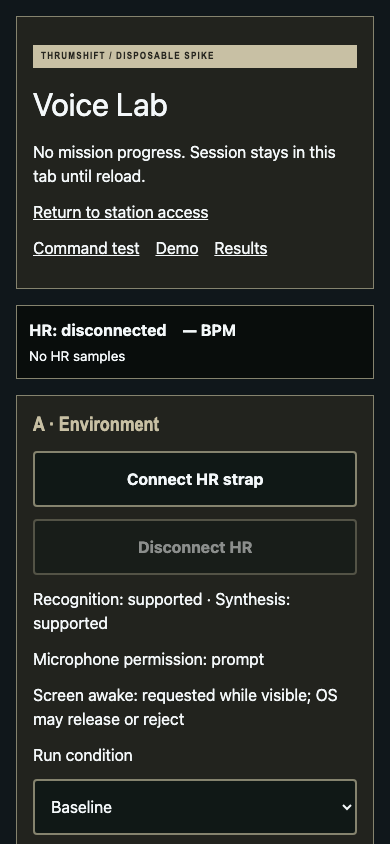
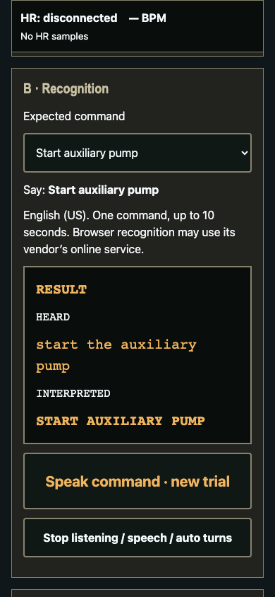

# Voice Lab feasibility spike

Open **`/voice-lab`** on the branch Preview HTTPS origin (or `npm run dev` locally). Direct reloads use the existing SPA fallback. The route is intentionally included in the built static app so phone testing uses the same artifact as the PR preview; it has no link from the normal game. Existing development diagnostics remain excluded from production. No deployment/configuration changes are needed.

This is a disposable, non-canonical equipment exercise. It does not import mission controllers, statistics, results, narrative artifacts, or either coolant puzzle. Returning to `/` starts the ordinary application. Removing `src/voice-lab`, its E2E test, these documents, and the entry-path selection in `src/main.tsx` removes the spike.

## Structure and observed capabilities

- `speech.ts`: constructor detection (`SpeechRecognition` or `webkitSpeechRecognition`), English/US, one final result, up to three exposed alternatives, ten-second limit, errors, abort, teardown, and an explicit ended-track probe. No continuous recognition or automatic game action.
- `commands.ts`: eight intents, normalization, whole-phrase allowlist and safe aliases. Competing complete commands are ambiguous. Near matches, negation, and unsupported phrases are unrecognized. Fuzzy matching is deliberately disabled. Only the first browser alternative is interpreted; the selected expected command never influences parsing.
- `presentation.ts`: platform synthesis at rates 1 and 0.85, cancellation and errors. Recognition and synthesis take turns to reduce feedback.
- `scenario.ts`: five deterministic decisions through the same intents used by buttons. No speech or HR dependency. It is a disposable audio interaction, not a proposed mission/canon change.
- `session.ts`: local trial/retry scoring. Demo attempts are separately labelled and excluded from recognition rates. No recording of audio, identifiers, persistence, analytics, LLM, or application backend.
- `VoiceLab.tsx`: reuses the existing Web Bluetooth HR source and Screen Wake Lock adapter. Wake Lock is requested while this foreground lab is visible. Backgrounding aborts voice and automatic turns and releases Wake Lock; foregrounding requests Wake Lock again but does not restart voice. Leaving the page cleans up speech, HR subscriptions/connection, timers and Wake Lock.

Repository inspection found no router: exact pathname selection with lazy imports keeps the mission composition root out of the lab. The existing simulator is used through the injected telemetry-source contract in component tests. Browser tests use injected speech APIs and never open a real Bluetooth chooser. Static Workers Builds previews already serve the production `dist` with SPA fallback; this PR does not deploy or change the provider setup.

Observed on November 7, 2026, against the built app at localhost in **Playwright's unmodified headless Chromium 149.0.7827.55 on macOS**, before microphone acquisition:

| Capability                                                                        | Observation                                               |
| --------------------------------------------------------------------------------- | --------------------------------------------------------- |
| Secure context                                                                    | true                                                      |
| Recognition constructors                                                          | `SpeechRecognition` and `webkitSpeechRecognition` exposed |
| Synthesis / utterance constructor                                                 | exposed                                                   |
| `getUserMedia` / `enumerateDevices`                                               | exposed                                                   |
| Microphone permission                                                             | `prompt`                                                  |
| Audio-input names                                                                 | one input, name hidden                                    |
| Web Bluetooth / Screen Wake Lock                                                  | exposed                                                   |
| Real recognition, audible synthesis, microphone routing, track probe, HR hardware | **not tested**                                            |

“Supported” in the lab means API presence, not a functioning speech service, available voices, permission, audibility, or acceptable accuracy. Chromium may use the browser vendor's remote recognition service and require connectivity; the app adds no speech service and makes no offline guarantee. Recognition and capture permissions can differ.

## Pixel Buds microphone limits

`enumerateDevices` can expose input names after permission, subject to Android/browser privacy and routing. The microphone inspection button briefly calls `getUserMedia({audio: true})`, reads only the capture track name, stops every track immediately, and refreshes input names. It does **not** select a device, hold the microphone open, or identify the separate speech-recognition input. There is no device ID in the UI/export. A Pixel Buds label is evidence of an exposed capture device, not proof that recognition uses that device. Android controls the active audio output; confirm it by listening.

[MDN documents `start(audioTrack)`](https://developer.mozilla.org/en-US/docs/Web/API/SpeechRecognition/start). [Compatibility data](https://caniuse.com/mdn-api_speechrecognition_start_audiotrack), consulted November 7, 2026, lists desktop Chrome support from 135 but **no Chrome for Android support**. API presence and `start.length` are insufficient to detect this overload.

The optional user-triggered probe supplies an already-ended audio track to a fresh recognizer. `InvalidStateError` is evidence of track validation; acceptance/ignoring or another error leaves support unverified. The recognizer is immediately aborted and its AudioContext closed. A browser ignoring the argument may briefly open its default recognition input. **Even observed validation does not prove live track routing.** This spike therefore always uses default browser-controlled recognition input and never claims to force the Pixel Buds microphone. A live selected-track experiment would require separately verified browser support and hardware evidence.

## Exact Android test procedure

Use the PR's successful Workers Builds **Preview**, append `/voice-lab`, and open it in Android **Chrome**, not an embedded browser. Do not substitute a production deployment. If no preview is available, the temporary HTTPS development workflow in [DEVELOPMENT.md](../../DEVELOPMENT.md) is an alternative; append `/voice-lab`.

1. Record phone model, Android/Chrome versions, Pixel Buds model, HR strap model/firmware if known, preview URL/revision, network connection, and treadmill pace/effort in tester notes. Keep phone volume at an understandable level. Mount the phone so the large controls and LISTENING state can be seen.
2. Start **Baseline**: quiet room, phone stationary, Pixel Buds disconnected, phone speaker. Choose that condition. Expand microphone/API inspection, inspect permission/input names, and note exactly what is exposed. Optionally run the ended-track probe and record its result; do not infer live routing. This probe is separate from scored attempts.
3. Tap each of the five spoken-message buttons at Normal, then Slightly slower. Confirm actual output by listening. Select the observed output and intelligibility rating; note missed words. The UI cannot infer output routing or treadmill noise.
4. Choose an **Expected command**, then tap **Speak command · new trial**. Wait for **LISTENING** and speak that canonical command once. Compare **HEARD** with **INTERPRETED**. Save failures as they occur; do not replace them with typed transcripts. A wrong recognized command is recorded even though it never actuates a game action.
5. If the first attempt misses, use **Retry last trial · attempt 2** once, without changing command/condition. A new-trial press starts a new denominator entry; an unretried miss remains a failure. Exercise all eight commands, preferably **ten new trials per command per condition** (80 trials/condition) for a useful first-pass estimate. Do not choose only easy commands or omit permission/network errors. Include some noncommands/negations and record any false positive separately in notes; a test attempt always retains its selected expected intent.
6. Save a labelled observation, then download JSON **before reload or closing the tab**. The export contains attempts, alternatives/confidence where exposed, parser results, errors, elapsed times, HR snapshots/sample counts, HR event log, per-condition summaries, saved observations, and current notes. It contains no audio recording or device IDs. Download after each condition to preserve evidence; use a fresh tab for a separate session if desired.
7. Repeat as **Pixel Buds**: pair/connect Buds in Android, quiet room, verify synthesized output in Buds, inspect newly exposed input names, and repeat recognition/message tests. Describe recognition input as **unknown** unless independently demonstrated; keep any capture-track observation separate. Compare with baseline rather than assuming Buds improve recognition.
8. Choose **Treadmill — easy**, wear the strap, and tap **Connect HR strap** to open the existing chooser from that gesture. Confirm connected status, live BPM and a fresh last-sample age in the pinned monitor. Begin normal walking with the treadmill operating and Buds connected. Repeat the same command/message trials while watching HR freshness. Record any disconnects, gaps of at least three seconds, audio switching or recognition interruptions. Reconnect only through the explicit button if needed. No automatic chooser/reconnect is used.
9. Repeat as **Treadmill — workout** at realistic effort, including audible breathing. Use the same command distribution. Record whether the screen remains awake throughout; distinguish an OS Wake Lock rejection/release from a speech failure. Compare Buds with phone mic/speaker under similar conditions where practical, using notes to identify that comparison.
10. For each condition, try **Start / restart demo** with **Automatic bounded turns (hands free)** checked. Grant initial recognition permission through a gesture first if needed. Wait for each spoken response, then LISTENING, before speaking the displayed command. The sequence is Scan cooling → Start auxiliary pump → Status → Scan power → Route power to cooling; Repeat is also valid. Each turn is a new bounded attempt after synthesis finishes and a 1.5-second pause. Complete all five decisions without touching on every turn. Two unclear/unavailable commands, speech errors, permission denial, or backgrounding pause automatic turns. Use Resume, Speak demo command, the tappable equivalent, or Stop as needed; record every intervention. Android may restrict gesture-free restarts: that is a feasibility result, not a reason to hide failures.
11. Check stop/cancel, denied permission and recovery, temporarily unavailable network, background/foreground, intentional HR disconnect/reconnect, and phone orientation. Confirm the lab retains no mission state. Save labelled notes on naturalness/frustration, response intelligibility, any need to touch the screen, and whether you want another scenario; download the final session.

For mobile accessibility, also check keyboard/focus visibility, screen-reader announcements, increased system text/200% zoom, landscape, and reduced motion. Large controls do not depend on hover. HR sample-gap events are local observations using the existing three-second staleness horizon, with occurrence time relative to session start, page visibility and whether voice was active; these are not causal diagnoses. Manual disconnects also appear in that log. No samples are invented across gaps. Wake Lock status reports request/capability rather than claiming a lock was granted.

## Decision record (hardware testing pending)

The automated suite can establish parser safety, bookkeeping, bounded attempts, injected HR coexistence, mobile layout and deterministic demo behavior. It cannot establish:

- actual Android recognition service availability, accuracy, alternatives/confidence calibration, or restart permission behavior;
- which microphone recognition uses, Pixel Buds input quality, or output intelligibility;
- Bluetooth audio/HR coexistence, RF reliability, real notification cadence or Wake Lock endurance;
- experience during treadmill noise/breathing, naturalness, frustration or desire to play again.

After hardware runs, compare first-pass recognition (target roughly 90%+ at workout pace), success within one retry, wrong-intent/false-positive observations, HR interruption evidence, intelligibility, Buds versus phone, touch interventions and subjective notes. Rates use all lab trials; errors count as misses, and skipped retries do not inflate within-two success. Confidence is displayed without using a vendor-dependent numeric threshold to actuate commands. Demo taps and voice attempts are excluded from lab accuracy rates. Do not decide go/no-go from API presence or automated tests.

## Review captures

These are local Chromium UI captures, not Android/hardware evidence. The heard/interpreted capture uses an injected transcript solely to show the UI distinction.

## Automated/local validation for this revision

Node 24.12.0 (supported): `npm run format:check`, `npm run lint`, `npm run typecheck`, `npm test` (650 tests), `npm run build`, `npm run e2e` (10 tests), and `npm run e2e:puzzle` (16 tests) passed. Build ran before production E2E. The sandbox initially prevented the preview server from listening; E2E was rerun successfully with local server/browser access. No real Bluetooth chooser was opened.

Local review covered 360/390px phones, 768px tablet, 1440px desktop, viewport resizing with the result retained, keyboard activation/visible focus, reduced motion, and a 320px view with 200% root text size (no page overflow). The diagnostic table has its own horizontal scroll. Forced-colors rendering was inspected locally. These are browser/layout checks; they do not replace Android accessibility, headset or treadmill verification.
